# Luma: Mantrac Engineering Intelligence Assistant

Luma is the product built on the Engineering Knowledge Assistant engine. It answers like an engineering
colleague: the answer comes first, in a natural sentence, and the source sits beside it as a citation.
Every equipment-specific value still has to pass the same citation validation as before.

| | |
|---|---|
| Desktop | 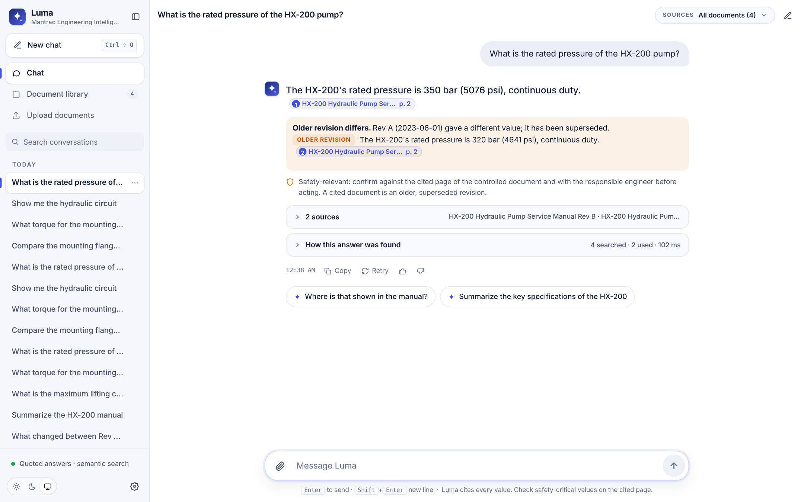 |
| Comparison | 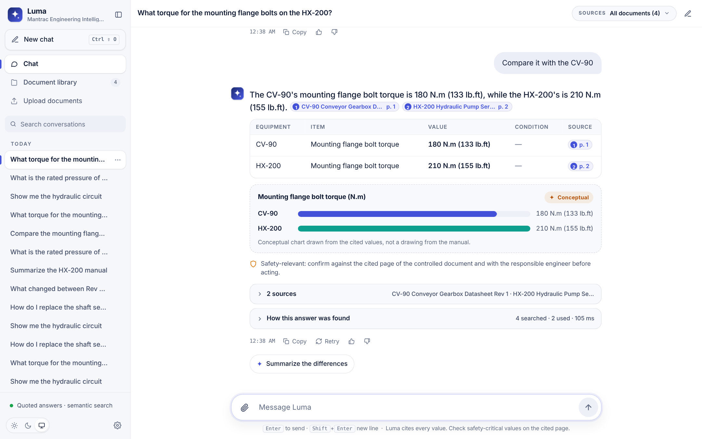 |
| Original figure | 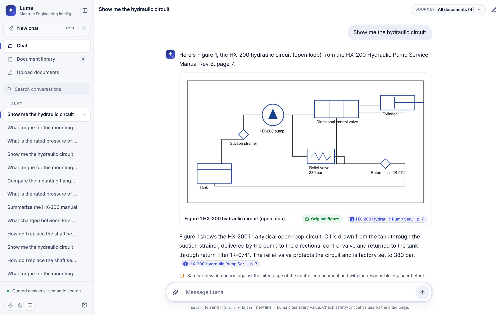 |
| Dark, with the source page | 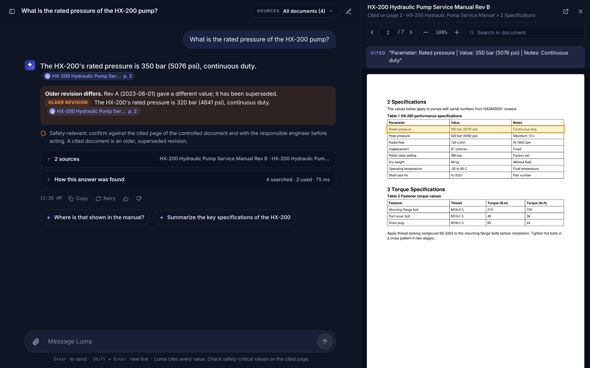 |
| Phone | 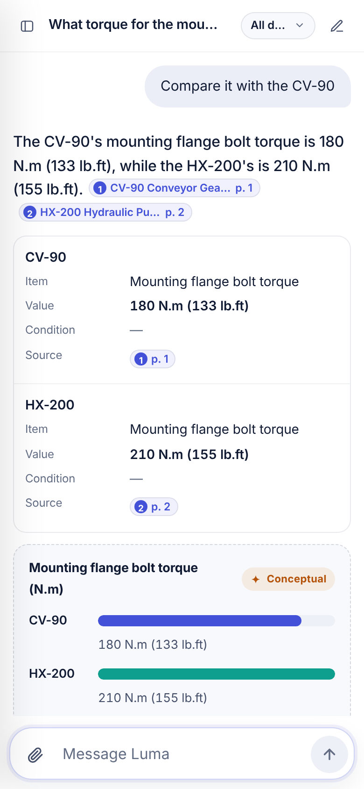 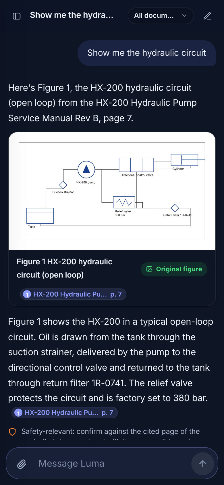 |

All screenshots in `docs/screenshots/luma/` are of the running application with the synthetic sample
documents. The values in them are invented test data, not real equipment data.

## How an answer is made

```
question ─ route (eka/conversation.py) ─┬─ where / simpler terms ──── the previous answer and its sources
                                         ├─ summary / revision diff ── the indexed passages of a document
                                         ├─ visual ─────────────────── the figure index (eka/figures.py)
                                         └─ direct / explain / compare / procedure
                                              retrieve (BM25 + vectors) → select evidence → gate
                                              → compose (eka/compose.py)  ─ or ─  local LLM (eka/generation.py)
                                              → validate every citation and every value (eka/citations.py)
```

**Answer modes** (`eka/modes.py`):

| Mode | Example | What Luma does |
|---|---|---|
| Direct | "What is the oil capacity of the CV-90?" | "The CV-90's oil capacity is 2.4 L." Without a model, the sentence is built only from the cells of the cited table row. The original row is kept as the citation excerpt and shown on hover. |
| Condition kept | "What is the rated flow of the HX-200?" | "…120 L/min at 1800 rpm". A value is never separated from its stated condition. |
| Clarify first | "What torque for the mounting flange bolts?" | Asks which machine, and shows no values until one is chosen. |
| Compare | "Compare it with the CV-90" (follow-up) | A one-sentence comparison, then a table with each value, its condition and its source. If the conditions differ, it says the values aren't directly comparable. A chart is drawn only for like-for-like values (same item, unit and condition), and it is labelled conceptual. |
| Summary | "Summarize the HX-200 manual", "key specifications of the CV-90", "important safety warnings", "the maintenance procedure" | An outline with each section's opening sentence, a specification table, every warning, or the procedure, all cited. Rev B is used unless you name Rev A. |
| Revision diff | "What changed between Rev A and Rev B?" | A table of the values that changed (both revisions cited), the statements that changed, and the sections added. |
| Procedure | "How do I replace the shaft seal?" | Warnings first, then the numbered steps in the document's order with every tool and torque value. Then a conceptual "at a glance" flow, labelled as not a manufacturer drawing. |
| Visual | "Show me the hydraulic circuit" | The original figure, cropped from its page, with the page cited. Clicking the figure opens the page. The text on that page about the figure follows it. |
| Where | "Where is that shown in the manual?" | The page, document and table of the previous answer, with a link to open it. |
| Explain / simpler terms | "Explain why…", "Explain that in simpler terms" | With a local model: an explanation grounded in the sources. General engineering knowledge appears in a separate block labelled "General engineering knowledge · not from your documents". Without a model, Luma says so and does not paraphrase. |
| Not established | "What is the maximum lifting capacity of the TL-5?" | "I couldn't verify the maximum lifting capacity of the TL-5 from the available technical information…", with what was searched and a request for the missing document. |

**Suggested follow-ups** are offered under the latest answer only. They are chosen from what the library can
answer: "Compare it with the CV-90" appears only if the CV-90's documents have the same row.

## The language model

* Provider: **Ollama**, local (`EKA_GENERATOR=ollama`, `EKA_LLM_MODEL`, `EKA_OLLAMA_URL`). Nothing is sent to a
  cloud service, and no model is downloaded by the application.
* Prompt (`eka/generation.py`): the Luma persona and voice rules (answer first, never "according to the
  documents"), grounding rules, mode-specific guidance and one short example. The JSON schema puts `claims`
  before `status`, so the model writes what the sources say before it decides whether it can answer. With
  `status` first, the 3B model declined answerable questions.
* Claim kinds:
  * `direct` and `inference` must cite retrieved passages and may only state numbers and identifiers that
    those passages contain.
  * `general` (concept explanations) must cite nothing, and is rejected if it states any number, part number or
    model name.
* Policy:
  * The model is used when the evidence supports an answer.
  * Clarification stays deterministic, because it offers the equipment as clickable options.
  * If the model declines, but a validated quoted answer exists, the quoted answer is shown and the
    reason is recorded (`fallback_reason`).
* **Tested against a real model:** `tests/test_llm_live.py` (5 tests) passes against **qwen2.5:3b-instruct**
  (Q4, 1.9 GB) running in Ollama 0.40.4 on a 4-core CPU without a GPU. This was in the development container
  only; nothing was installed on a user's machine.
  * Typical latency: 8–15 s per answer.
  * The tests cover:
    * direct answers with validated citations;
    * value plus condition, with the superseded revision never given as the answer;
    * abstention on a missing value;
    * explanations whose general-knowledge claims are value-free;
    * "simpler terms" keeping the value.
  * **Observed limitation:** one general-knowledge sentence from the 3B model was partly wrong. It said a
    clogged strainer leads to "higher pressure"; it lowers inlet pressure. That is exactly why general claims
    are labelled as not coming from the documents. **qwen2.5:7b-instruct** (4.7 GB, 8 GB RAM recommended) is
    the recommended model, but it was not tested here. Check the hardware and get approval before pulling it.
* In the packaged app (screenshot `screenshots/luma/desktop-llm-explain.jpg`), with qwen2.5:3b on CPU, the
  answer below took 41 s. Its grounded claim is cited, and its two general-knowledge sentences sit in the
  labelled block; one of them is wrong (see the limitation above). For "Explain that in simpler terms", the 3B
  model's rewrite failed validation, so Luma declined to paraphrase instead of showing an unverified version.
* Without a model, Luma is fully usable in **quoted mode**: natural sentences for table values, exact source
  sentences otherwise, and a clear note where an explanation would need the model.

## Visual capabilities: implemented vs planned

| Capability | Status |
|---|---|
| Find embedded raster images (photos, scanned drawings) per page, with bounding box | **Implemented and tested.** Full-page scans are excluded. |
| Find vector drawings (schematics, diagrams, charts) as clusters of paths | **Implemented and tested.** Table grids and framed warnings are excluded. |
| Caption ("Figure 1 …"), labels inside the drawing, and section for each figure | **Implemented and tested** |
| "Show me…" answers with the original figure cropped from its page, cited, opening the page on click | **Implemented and tested** (pytest and browser) |
| Figure count per document in the library and API (`/api/documents/{id}/figures`, `/api/figures/{id}/image`) | **Implemented and tested** |
| Conceptual comparison chart from cited values (like-for-like only, labelled) | **Implemented and tested** |
| Conceptual procedure flow from cited steps (labelled) | **Implemented and tested** |
| Explaining a schematic from the drawing itself (reading symbols and connections) | **Not implemented.** Luma shows the text the manual prints about the figure, and nothing beyond it. |
| Conceptual component-relationship diagrams generated from text | **Planned, not implemented.** This needs careful grounding to avoid inventing layouts. |
| Figures in scanned pages (finding a drawing inside a page image) | **Not implemented.** Scanned pages are read as text only. |
| 3D | **Not implemented.** The sample documents contain no CAD or 3D content. The next step would be to detect embedded PDF 3D annotations (U3D/PRC) and attached CAD files, and report them. Arbitrary PDFs are not converted into 3D models. |

## Branding

`eka/static/brand/` holds the product name and tagline (`brand.js`), the navy/indigo palette for both themes
(`brand.css`). The Luma mascot (`eka/static/luma/`) is the product mark, see below.

The Mantrac logo (the Mantrac and CAT dealer lockup) is `eka/static/brand/org-logo.png`, the file supplied by
the project owner. It is used unmodified; only its empty white margin was trimmed. It sits at the foot of the
sidebar at its own proportions, the same in light and dark themes. Nothing was drawn or approximated. To
change it, replace that file with another authorized one. Formal approval from Mantrac's brand team (and for
the CAT mark, which belongs to Caterpillar) has not been checked here.

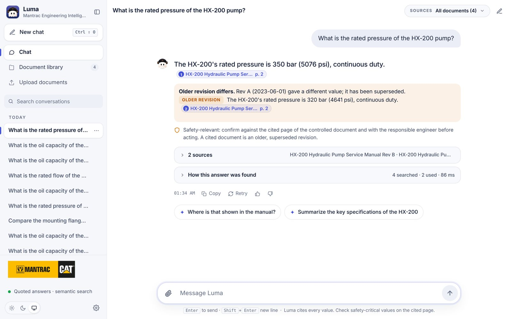

## Luma, the mascot

| | |
|---|---|
| States, as observed in the running app | 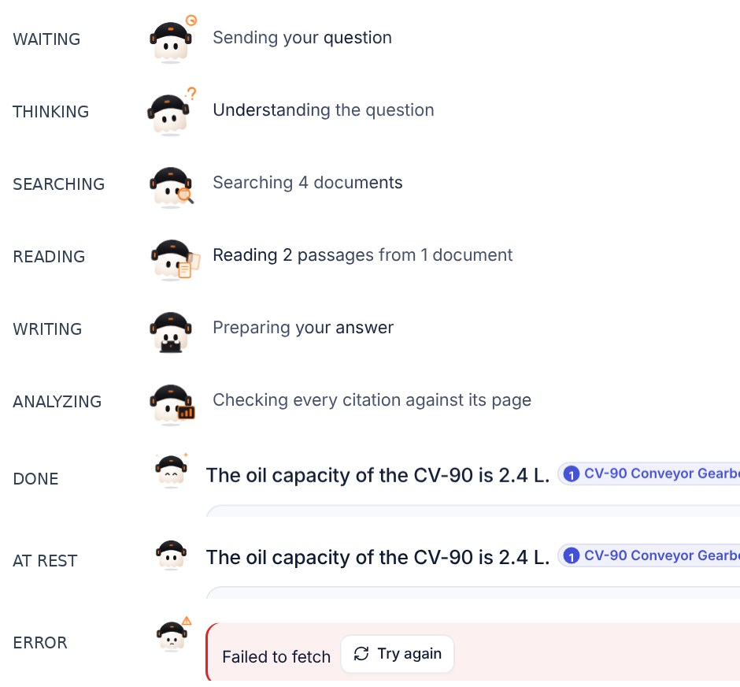 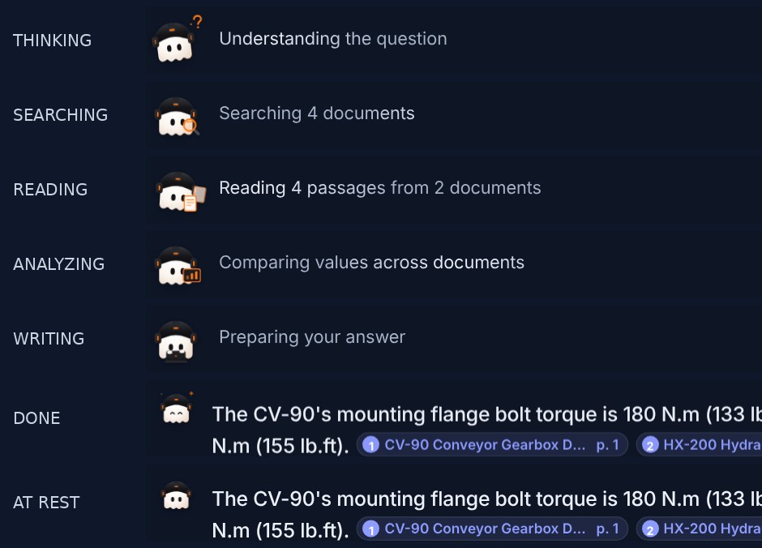 |
| Welcome screen | 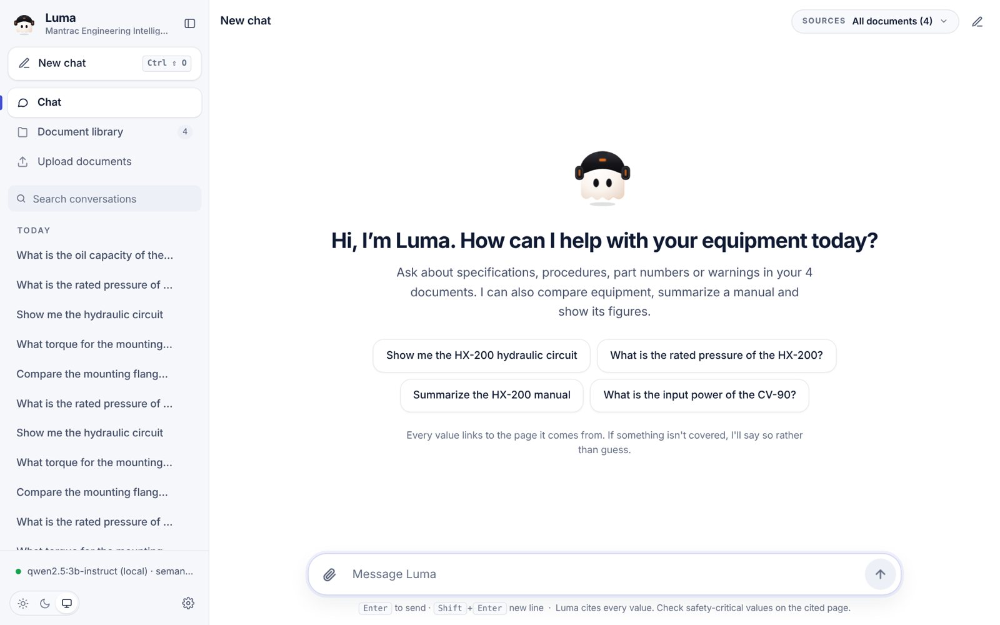 |
| App icon | 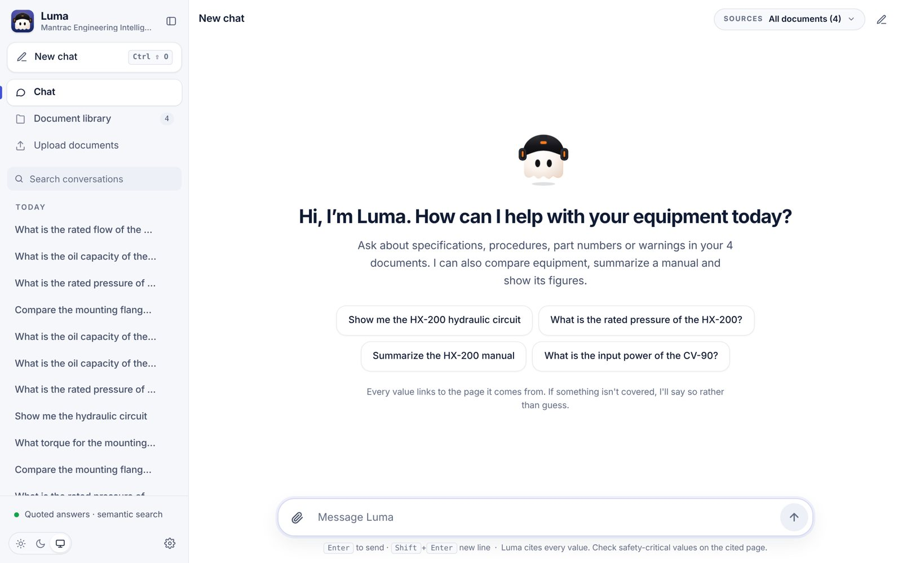 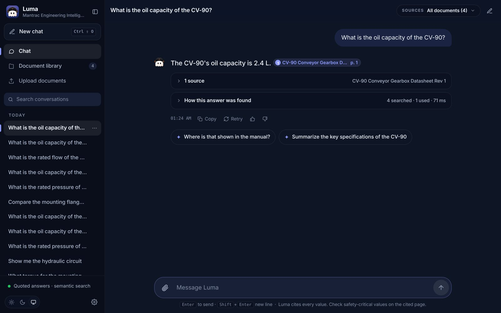 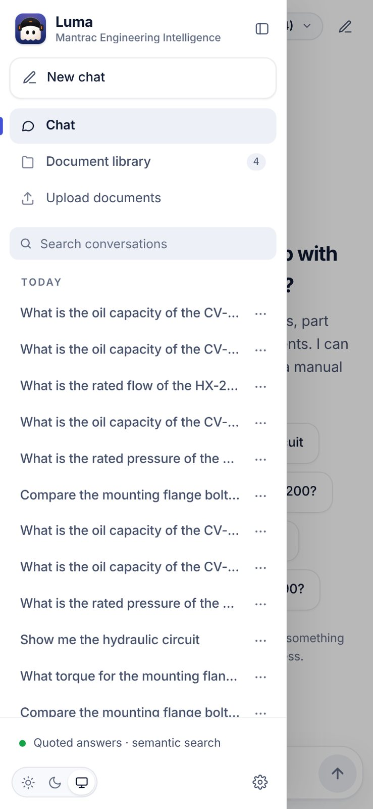 |
| Phone | 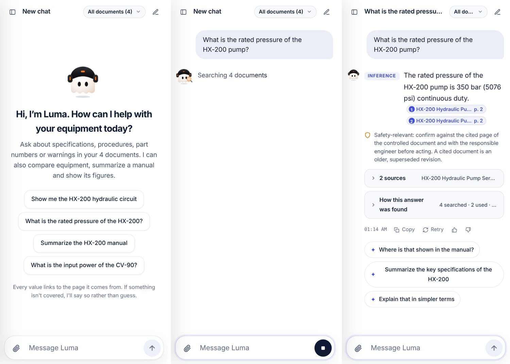 |
| Recording | [`recording-idle-to-done.mp4`](screenshots/luma-mascot/recording-idle-to-done.mp4): idle → thinking → searching → reading → writing → checking → done → at rest |

### Asset

* `eka/static/luma/luma-mascot.svg` is the only asset: an original vector drawing made from the approved concept
  images (kept for reference in `docs/luma-mascot/`). The concept images have opaque dark backgrounds, so
  they are not used directly. Cutting them out would leave halos.
* One file holds every state. Each state is a group (eyes, helmet LED, ear-cup LEDs, and a prop such as a
  magnifier, pages, bars, a laptop, sparks or a warning sign). CSS shows the group for the current
  `data-state`. The file has a transparent background and is readable at 22–24 px.
* As a plain ``, the file shows the neutral pose. It is used that way for the favicon, the sidebar
  brand mark and the avatar beside finished answers. It is also the fallback until the animated copy has
  loaded.
* `eka/static/luma/luma-icon.svg` is the app icon: Luma's head on a navy tile, readable at 16 px. It is the
  sidebar mark, the browser-tab icon (`favicon.ico` for older browsers) and the installed-app icon
  (`manifest.webmanifest`, 192 and 512 px PNGs, 180 px for iOS home screens).
  
* To replace the artwork, keep the group class names (`lm-fig`, `lm-p-search`, `lm-eyes-happy` and so on)
  that the mascot section of `eka/static/app.css` targets.

### Component

`eka/static/luma/mascot.js` exports `LumaMascot` and `staticMascot()`:

* `new LumaMascot({ size, state, rest })` builds an inline copy of the SVG. Ids are made unique so two
  copies never share gradients.
* `.set(state)` changes the state. `done` plays once (about 1 s), then settles to `rest`.
* `.destroy()` removes it.
* An IntersectionObserver pauses the animation while the mascot is off screen.

### States are driven by real events only

The server streams a `stage` event, with a `phase`, at each real step of the pipeline (`eka/answer.py`,
`eka/modes.py`). The UI maps each phase to a state; there are no timers that invent progress.

| Real event | Label (examples) | State |
|---|---|---|
| Request sent, nothing received yet | "Sending your question" | WAITING |
| `understanding`: routing the question | "Understanding the question" | THINKING |
| `searching`: hybrid retrieval, figure search | "Searching 4 documents" | SEARCHING |
| `reading`: evidence selected, document opened | "Reading 2 passages from 1 document" | READING |
| `analyzing`: comparing, building a summary or revision diff | "Comparing values across documents" | ANALYZING |
| `writing`: composing, or the local model writing | "Writing the answer with qwen2.5:3b-instruct" | WRITING |
| `checking`: every citation validated against its page | "Checking every citation against its page" | ANALYZING |
| The answer is rendered on screen | | DONE, then at rest |
| The request failed (network or server) | the error and "Try again" | ERROR |
| Stop pressed | | removed |
| Library: a document queued or being indexed | | WAITING / READING |

* A step only appears if it actually ran. "hello" shows only THINKING. A summary goes from THINKING to
  READING to ANALYZING with no SEARCHING.
* Every request gets its own mascot. A follow-up starts again at WAITING and never inherits the previous
  state. The finished answer keeps a still avatar.
* The welcome screen shows a larger mascot in IDLE (a slow float, blink and LED breathing).

### Animation, accessibility and performance

* Only `transform` and `opacity` are animated, with CSS keyframes. There is no layout work and no JavaScript
  animation loop.
* `prefers-reduced-motion`: every mascot animation is off. The state is still shown by the pose and prop,
  and the text label always says what is happening.
* The mascot is decorative (`aria-hidden`). The text label beside it says what is happening; the label
  is in the conversation log, as before.
* Sizes: 32 px in the sidebar and beside answers, 44 px while working (38 px on phones), 88 px on the
  welcome screen (72 px on phones). Light and dark themes are both checked.

### Verification

* `tests/test_conversations_api.py`: the stream's phases follow the real pipeline for a direct answer,
  a greeting, an abstention, a summary and a comparison. The demo delay is off by default.
* `tests/ui/e2e.mjs`, observed in Chromium with a MutationObserver:
  * the exact state sequence for a model answer (`waiting → thinking → searching → reading → writing →
    analyzing → done → static`) and the matching labels;
  * DONE only after the answer is on screen;
  * at rest afterwards, a follow-up starting fresh, Stop removing the mascot;
  * the ERROR state on a network failure, cleared by "Try again";
  * IDLE on the welcome screen, paused while hidden;
  * no animation under reduced motion.
* The screenshots and recording above come from the running app with the local qwen2.5:3b model on CPU.
  * Every state was observed: IDLE, WAITING, THINKING, SEARCHING, READING, ANALYZING, WRITING, DONE,
    at rest and ERROR.
  * WAITING was captured by holding the request for 2 s in the browser test. ERROR was captured with a
    real network failure caused by the browser test.

### Limitations

* **Demo delay.** Without a language model, the steps take milliseconds, so the states flash by. That is
  correct, because nothing is slowed down to look busy. For the screenshots, the recording and the UI
  tests, `EKA_DEBUG_STAGE_DELAY_MS` (off by default; for demos and tests only) paused 0.6–0.9 s at each
  step. The recording also shows the writing step 6× faster, and is labelled as such.
* **Artwork.** The mascot is a vector recreation of the concept, not the concept image itself. It has
  not been reviewed or approved by Mantrac's brand team.
* **No streaming progress.** WRITING lasts as long as the model takes. There is no token-by-token
  progress, because the answer is validated as a whole before it is shown.

## Interface

* Built on the ATLAS design system's structure and tokens (see [UI.md](UI.md)), with a Luma layer in
  `app.css`. The layer uses system typography (SF/Segoe), soft surfaces, a translucent top bar, prose answers
  with inline citation chips, data tables that become labelled records on phones, figure cards, and dashed,
  labelled conceptual visuals.
* Motion:
  * message entrance;
  * answer blocks arriving in quick succession (45 ms apart);
  * the sidebar and the document panel;
  * expanding sources;
  * bars growing;
  * theme changes cross-fading (View Transitions).

  Everything is disabled under `prefers-reduced-motion`, which is tested.
* The PDF viewer stays closed until a citation is clicked. It is a side panel on desktop, an overlay on
  tablets and full screen on phones.

## Verification

* `python -m pytest`: **135 passed**, with `EKA_TEST_MODEL_DIR` (real embeddings) and
  `EKA_TEST_OLLAMA_MODEL=qwen2.5:3b-instruct` (real LLM). Without them, 128 pass and 7 are skipped.
  `tests/test_luma.py` holds 23 tests for:
  * natural answers that keep exact values (checked over every table row in the library);
  * conditions, ambiguity and abstention;
  * comparisons, summaries, revision differences and "where";
  * follow-ups, figures, the figure API and the general-claim validation.
* `tests/ui/run.sh`: **144/144 browser checks pass** (Chromium; desktop, tablet and phone; light and dark;
  reduced motion). These include the 24 Luma checks and the mascot checks below.
* `scripts/run_eval.py`: behaviour is unchanged from the previous release in all four configurations (see
  [EVALUATION.md](EVALUATION.md)). There are 0 unsupported claims and 0 invalid citations.

## Starting

The same as before: `setup.bat` and `start.bat` (or `./setup.sh` and `./start.sh`); see `START_HERE.md`.
For conversational answers, install Ollama, check the hardware, pull an approved model, then set
`EKA_GENERATOR=ollama` and `EKA_LLM_MODEL=<model>` in `config.env`.

## Known limitations

* Vocabulary gaps remain in quoted mode. For example, "How fast does the output shaft turn?" doesn't match
  "output speed". Semantic search narrows these gaps, and a model helps phrase answers, but retrieval still
  decides what can be answered.
* Comparisons pick the best-matching row per machine. They do not compare whole specification tables in one
  answer.
* Summaries are extractive outlines (each section's first sentence). With a model, they are not yet
  rewritten into prose.
* Figure search relies on captions, labels and nearby text. A figure with none of these is found only by its
  document and page.
