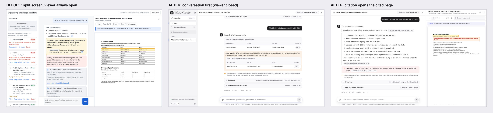
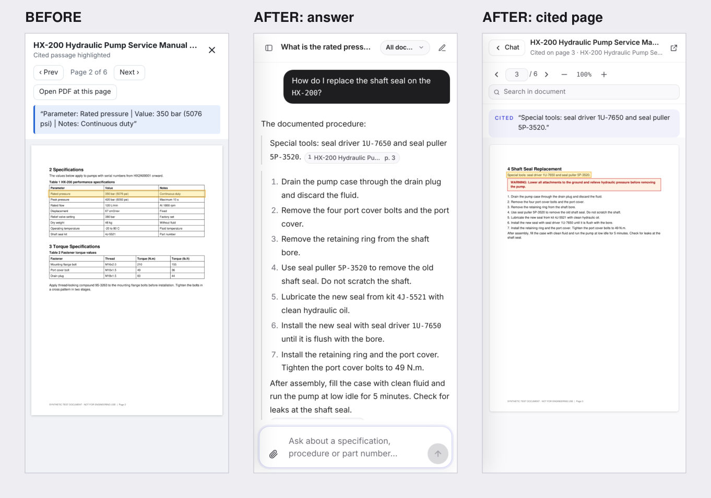
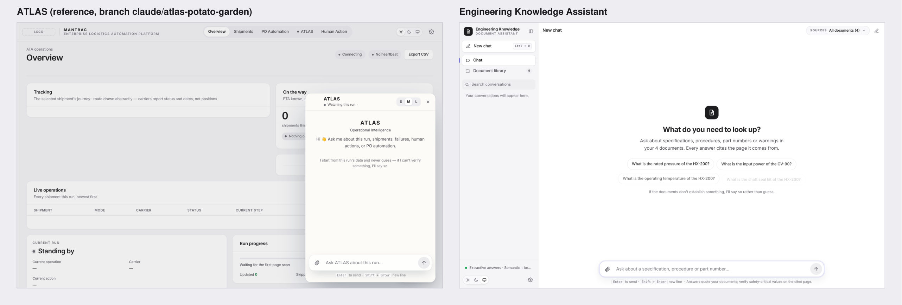

# Interface

The interface is a conversation-first assistant in the **ATLAS visual family**, with a ChatGPT-style layout:

- a collapsible sidebar holding history, the document library and settings;
- a centred reading column;
- a composer anchored at the bottom;
- a document panel that opens only when you click a citation.

## Source of truth: the ATLAS UI

| | |
|---|---|
| Branch | `claude/atlas-potato-garden` (latest ATLAS commit, 2026-10-14; `claude/maia-m6rhri` carries an older copy of the same file) |
| File | `control-tower/dashboard/static/index.html` (CSS lines 24–2316, JS 3055–7538) |
| Also inspected | `control-tower/controlplane/static/login/login.css`, `login.html` |

Only ATLAS's visual system is reused. Its application logic, its character artwork and its API are not used, and nothing in the ATLAS branch was modified.

### Design tokens reused (values copied, `eka/static/app.css` `:root`)

ATLAS renders with its *polish layer* (lines 2151–2190), which overrides the base tokens. The values below are the ones ATLAS actually displays.

| Token | Light | Dark | ATLAS source |
|---|---|---|---|
| `--bg` page | `#F5F5F7` | `#0B0E14` | polish layer |
| `--surface` card / main | `#FFFFFF` | `#141922` | polish layer |
| `--surface-2`, `--surface-3` | `#F9F9FB`, `#EEEEF1` | `#10141C`, `#1C2230` | polish layer |
| `--ink`, `--mid`, `--faint` | `#1D1D1F`, `#4B4B52`, `#6E6E76` | `#F2F4F8`, `#B1B8C4`, `#8C95A4` | polish layer |
| `--line`, `--line-2`, `--line-hi` hairlines | alpha black .08 / .055 / .13 | alpha white .08 / .05 / .14 | polish layer |
| `--brand` / `--solid` / `--vio` accent | `#4B50D8` | `#8A8DF7` / `#5A5EE6` / `#9A9DF8` | polish layer |
| status `--grn`, `--y`, `--red`, `--blu` (+ washes, dots) | as ATLAS | as ATLAS | lines 79–99, 167–171 |
| `--ch-me` your message bubble | `#1D1D1F` | `#2B3245` | polish layer |
| `--s`, `--mono` system type stacks | — | — | lines 118–121 |
| `--t-title`, `--t-label` type roles | — | — | polish layer |
| `--e` easing `cubic-bezier(.23,1,.32,1)`, `--ch-spring` | — | — | polish layer, line 1621 |
| `--r` 12 / `--r-sm` 9 / `--r-lg` 16 radii | — | — | polish layer |
| `--shadow`, `--lift` | — | — | polish layer |
| `--ch-col` 760px reading column | — | — | line 1621 |

The theme mechanism is the ATLAS one: Light / Dark / System, applied before first paint, a `theme-switching` class so nothing animates through the change, and a `matchMedia` listener for System.

### Components reused

| ATLAS component | ATLAS lines | Used here for |
|---|---|---|
| Conversation workspace `#chat`: `.ch-b` column, `.msg/.bub`, `.ch-empty`, `.ch-chip` | 1612–1722, 1790–1805 | The conversation |
| `.ch-box` composer, `.ch-ta`, `.send` (spinner/stop), `.attach`, `.ch-hint` + `kbd` | 1806–1836 | Composer |
| `.th` / `.th-label` shine / `.th-dots` | 1776–1787 | "Working" state, labelled with real pipeline stages |
| `.fb` time + actions, quiet until hover | 1736–1746 | Copy · Retry · helpful / not helpful |
| `.evx` disclosure | 1759–1768 | "N sources" and "How this answer was found" |
| `.dl` action pills | 1748–1758 | Clarification options |
| `.cl-k` claim labels | 1722–1733 | "Inference", "Older revision" labels |
| `.ch-ctx` context pill | 1662–1672 | "Sources: All documents" scope selector |
| `.ch-jump` | 1837–1841 | "Latest" button |
| `.nav-i` / `.nav-g` / `.nav-c` with the brand marker | 385–410 | Sidebar items, history groups, counts |
| mobile `.nav` drawer + `.scrim` | 1401–1430 | Phone sidebar |
| `.seg`, `.pf-th` | 848, 1484 | Theme switchers |
| `.cbtn` / `.ibtn` / `.pill` / `.card` / `.in` / `.empty` / table rhythm | polish layer, 877 | Library, settings, panel toolbar |
| `.mini` key/value card; phone "rows become labelled records" | 1287–1294, 1436–1452 | Specification tables (and their phone layout) |

## What changed from the previous design

| Before | After |
|---|---|
| Three fixed panes; the PDF viewer took ~44% of the width as soon as a citation was clicked | The conversation is the page. The document panel is closed by default and opens beside the chat only from a citation or "Open". If the chat would drop below 640px, the sidebar folds while reading and comes back on close. The panel is resizable, closes with Esc, and preserves the reader's exact position |
| Generic blue-on-grey theme, borders everywhere | ATLAS tokens, hairlines and one soft shadow, system type |
| Ambiguous equipment: every model's value shown, then a question | **Clarification first**: one question with clickable equipment options and no values. The chosen option is answered from that model's document only |
| Citation numbers `[1]` | Source pills beside the claim they support ("HX-200 … p. 2"), compact inside tables |
| Spec rows as text `Parameter: X \| Value: Y` | A specification table with the table's caption; labelled records on phones |
| History in the browser only | Server-side, searchable, grouped by date (Today / Yesterday / Previous 7 days / …), with rename and delete |
| One-shot request | Server-sent events stream the real pipeline stages. **Stop** discards the answer, and a stopped answer is not saved |

## Interactions verified in a real browser

`tests/ui/run.sh` starts fresh servers and runs `tests/ui/e2e.mjs`, Playwright on Chromium. All **100 checks pass**. They cover the following, grouped by area.

**Desktop (1440×900)**
- **Composer:** suggestions; streamed stages; Shift+Enter.
- **Answers:** spec table; revision note; safety note; copy to clipboard; feedback; retry; sources and trace disclosures.
- **Clarification:** clarify-first, and the option click.
- **Procedures:** steps kept in document order.
- **Document panel:** the citation opens the panel at the cited page with the quote, and the layout doesn't shift. The chat stays at least 600px wide. Prev / next / page number, zoom, search in the document, opening a match, drag-resizing and close all work, and the reader's position is preserved.
- **Scope:** narrowing to one document, and back to all.
- **History:** reopening a conversation; search, rename and delete; New chat; Ctrl+Shift+O, Ctrl+K and Ctrl+. shortcuts.
- **Theme and settings:** Light/Dark/System; settings via the X and via Esc; `/` focus; Tab order.
- **Error handling:** network failure, then Try again.
- **Library:** status pills; the failure reason; filtering; rejecting a non-PDF; uploading to Ready; long-title truncation; the page-status table; re-index; delete; Open.
- **Wide content:** a wide 7-column table with no page overflow.
- **Attachments:** the attachment chip from upload through to Ready, and dismissing it.

**Dark theme**
- Document panel layout.
- Measured text contrast for every text token on every surface in both themes: the worst case is 4.64:1, and all pass 4.5:1.

**Tablet (820×1180)**
- The document opens over the conversation, and Back returns to it.
- No overflow.

**Phone (390×844)**
- The drawer opens and closes.
- The message box is 16px, so iOS doesn't zoom.
- Suggestions are unique.
- Long answers are shown from their question, with no overflow.
- Spec rows render as labelled records.
- Citations open a full-screen document view with Back.
- The library fits the screen.

**Slow model: uses a MOCK model** (`tests/ui/slow_ollama.py`, replies after 6s)
- The loading state names the real stage ("Writing the answer with qwen2.5:7b-instruct").
- Send turns into Stop, and stopping leaves nothing in history.
- The answer arrives cited.
- The method shows the model used.

Defects these runs found and fixed:

- The conversation collapsed to zero width at ≤880px (grid auto-placement).
- The page shifted 22px when the panel opened (unbounded grid row).
- Panel resize stalled (pointer capture).
- The reader's position drifted after a resize.
- Duplicate suggestion chips.
- Stale scroll timers.
- Ctrl+K focus being stolen.
- Suggestion checks calling the LLM.
- Spec tables squeezed on phones.

## Not verified

- Safari and Firefox: Chromium only.
- Real touch devices: touch is emulated.
- Screen readers: semantics and labels are in place but were not tested with a screen reader.
- A real Ollama model in the UI: only the mock was used.
